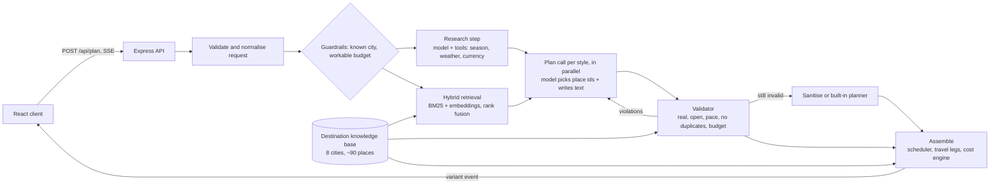

# Roamio

**An AI trip planner that keeps its promises about money, time and places.**

Tell Roamio where you are going, for how many days, with how many people and what budget. It streams back three complete itineraries (Budget Explorer, Balanced Journey, Comfort & Experiences) with a day-by-day schedule, a map, travel times and a cost breakdown that is guaranteed to fit your budget.

Most "GenAI travel planners" send one prompt to a model and print whatever comes back. That produces invented places, wrong prices and plans that ignore your budget. Roamio treats the model as a **proposer** and puts a **referee** (plain code) around it.

> Live demo: _add your Render / Vercel URL here_ · Screenshots: _add after deploying_

## What makes it different

| Problem with a naive LLM planner | What Roamio does |
| --- | --- |
| Invents places, hours and prices | **Closed-world RAG.** The model may only pick from places retrieved from a curated knowledge base, by id. Every place has coordinates, opening hours, duration and price. |
| Ignores the budget | **Deterministic cost engine.** The model never writes a number. Code computes stay, food, transport, activities and contingency, and sizes the activity budget so the total cannot exceed what you typed. |
| Returns malformed or rule-breaking JSON | **Validate, repair, degrade.** Zod schema check, then domain rules (real place, open that day, pace limits, no duplicates, budget). Failures go back to the model with the exact problems. If repairs run out, bad picks are removed by rules; if the model is down, a built-in planner takes over. The user always gets a valid plan. |
| Guesses travel time and schedules | **Deterministic scheduler.** Finds the visiting order that respects opening hours with the least travel, inserts lunch and dinner, and computes legs from coordinates (haversine × road factor). |
| Makes up the weather | **Tool calling.** The model can call `get_season_info`, `get_weather_forecast` (Open-Meteo) and `convert_currency` (Frankfurter). Numbers shown to the user come from tool results, not model prose. |
| Slow: waits for everything | **Streaming + parallelism.** Server-Sent Events. The three itineraries are built in parallel and each appears the moment it is ready. |
| Burns your API key | **Cost controls.** Concurrency and requests-per-minute limiter, retries with backoff, per-request and daily call caps, rate limits per IP, result cache. |
| Can't be trusted without evidence | **Built-in evaluation harness** (`npm run eval`) that measures first-draft validity, repair rate, budget compliance, latency and cost, and an independent audit of every plan. |

## Architecture



The model's job is narrow: **which** places on **which** day, plus the words. Everything checkable is done by code.

### Request lifecycle

1. **Validate** input with Zod (bounds on days, travellers, budget, free text is cleaned and capped).
2. **Guardrails** reject unknown destinations (404) and budgets below the cheapest workable plan (422, with the minimum), before any model call.
3. **Cache** lookup. The budget is rounded down to a bucket so near-identical requests share a result, and the plan is built for the rounded budget, so it is still within the real one.
4. **Research** (only if you gave a start date or a display currency): one model call with tool definitions. Tool arguments are validated because they are untrusted.
5. **Retrieve** candidate places with hybrid search: BM25 (lexical) and cosine similarity over embeddings, fused with Reciprocal Rank Fusion, after hard filters (month availability, cost).
6. **Plan** each affordable style in parallel. The prompt lists the candidates, per-day limits and the activity budget. Output must be JSON.
7. **Check** the draft. Up to two repair rounds quote the exact problems back to the model.
8. **Assemble** with code: order, times, lunch/dinner, travel legs, costs, per-day ledger.
9. **Stream** each finished itinerary to the browser as a `variant` event, then a `done` event with timings, token counts, validation outcomes and tool calls (shown in the "Under the hood" panel).

## Quick start

Requirements: Node 22 (20.12+ works).

```bash
npm run install:all

# Terminal 1: API on :8080. Without GEMINI_API_KEY it uses an offline mock model.
cp server/.env.example server/.env      # then edit values
npm run dev:server

# Terminal 2: client on :5173 (proxies /api to :8080)
npm run dev:client
```

Open http://localhost:5173. With no API key the app still works end to end, using a deterministic stand-in for the model, so you can explore the UI and run the tests for free. Add `GEMINI_API_KEY` to `server/.env` to use Gemini.

### Configuration

| Variable | Default | Purpose |
| --- | --- | --- |
| `GEMINI_API_KEY` | _empty_ | Enables Gemini. Empty means mock mode. |
| `GEMINI_MODEL` | `gemini-3.8-flash` | Generation model. Check the [model list](https://ai.google.dev/gemini-api/docs/models); ids change. |
| `GEMINI_FALLBACK_MODEL` | `gemini-3.5-flash-lite` | Used automatically if the primary id returns 404 for your key. |
| `GEMINI_EMBED_MODEL` | `gemini-embedding-001` | Embeddings for retrieval. If unavailable, local embeddings are used. |
| `LLM_RPM` | `0` | Max model calls per minute. Set to your key's limit (free tiers are low). |
| `LLM_CONCURRENCY` | `6` | Parallel model calls. |
| `LLM_THINKING_LEVEL` | _unset_ | `MINIMAL`/`LOW` lowers latency and cost on thinking models. |
| `LLM_MAX_CALLS_PER_DAY` | `1500` | Hard daily ceiling on model calls for the whole server. When reached, plans fall back to the built-in planner. |
| `MONGODB_URI` | _empty_ | Persistent accounts and trips. Empty means in-memory. |
| `JWT_SECRET` | random | **Required in production.** |
| `CLIENT_ORIGIN` | `http://localhost:5173` | Comma-separated allowed origins when the client is hosted separately. |

## Deploy

Full click-by-click guide: [docs/DEPLOY.md](docs/DEPLOY.md). Short version:

1. **Database:** free [MongoDB Atlas](https://www.mongodb.com/atlas) M0 cluster, one database user, network access `0.0.0.0/0`, connection string ending in `/roamio`.
2. **API + app:** [Render](https://render.com) → **New → Blueprint** → pick this repo. It reads `render.yaml`; set `GEMINI_API_KEY` and `MONGODB_URI`. The Docker image builds the React app and serves it from the API (one URL, no CORS).
3. **Check:** open `/api/health`. It should show `provider: gemini` and `store: mongo`.
4. *(Optional)* host the React app on Vercel (root directory `client`, env `VITE_API_URL` = Render URL) and set `CLIENT_ORIGIN` on Render to the Vercel URL.

Render's free tier sleeps when idle, so the first request after a while takes about a minute. Free Gemini keys have low rate limits, so set `LLM_RPM`; a plan makes 3 to 4 model calls (more if a draft needs repair).

## Testing and evaluation

```bash
npm test          # 39 tests: knowledge base, retrieval, cost engine, scheduler, tools, validation, repair, pipeline, API
npm run eval      # evaluation harness (mock model unless GEMINI_API_KEY is set)
npm run eval -- --n 40 --judge     # more cases, plus an LLM-as-judge quality score
```

The tests include a property test: 60 generated trips with 60% of model answers deliberately corrupted (truncated JSON, invented ids, duplicates, overspending, overpacked days). Every resulting itinerary must still be within budget, use only real places and have no duplicates.

The eval harness runs a seeded set of cases (every destination, 1–7 days, 1–8 travellers, tight to generous budgets, plus guardrail and prompt-injection cases) and independently audits each result against the knowledge base.

### Results (fill in from your own run)

Run `GEMINI_API_KEY=... npm run eval` and paste the generated `server/eval/RESULTS.md` here. Do not publish numbers from the mock model: they only prove the pipeline machinery, and the harness writes them to separate `*.mock.*` files for that reason.

| Metric | Gemini run |
| --- | --- |
| First draft valid, no repair | _from your run_ |
| Valid after repair | _from your run_ |
| Itineraries within budget | _from your run_ |
| Independent audit passed | _from your run_ |
| Time to first itinerary (p50) | _from your run_ |
| Cost per plan | _from your run_ |

## Project layout

```
server/
  data/                 destination knowledge base (one JSON file per city)
  src/kb/               loader (Zod-validated), BM25, embeddings, hybrid retriever
  src/llm/              Gemini + mock providers, limiter, retry client, validate-and-repair
  src/tools/            weather, currency, tool registry (declarations + validated handlers)
  src/planner/          prompts, schemas, validator, cost engine, scheduler, assembler, pipeline
  src/routes, store, middleware   API, Mongo/memory persistence, auth, rate limits, SSE
  test/  eval/          unit + integration tests, evaluation harness
client/                 React + Vite app (form, streaming results, map, saved and shared trips)
docs/                   architecture notes and interview guide
```

## Design decisions and trade-offs

- **Closed world over open world.** The planner only covers destinations in the knowledge base (8 cities now). That is a deliberate choice: accuracy and zero invented places beat coverage. Adding a city is one JSON file, validated at startup (see `docs/ADDING_DESTINATIONS.md`).
- **The model does not do arithmetic.** LLMs are unreliable with money; code is exact. The model is asked only for choices and prose.
- **Batching reduces calls.** One plan call per style (not per day) means about 3 to 4 model calls per request.
- **Repair before fallback.** A repair round costs one call and usually fixes the draft; a deterministic fallback guarantees a valid result even when the model is down or the daily allowance is spent.
- **Hybrid retrieval.** BM25 catches exact words ("stepwell"), embeddings catch meaning ("sunset spot"); RRF combines them without tuning score scales.
- **In-memory limiter and cache.** Fine for a single instance. For several instances, move both to Redis.

## Limitations

- Prices and opening hours are curated approximations in INR for Indian-resident travellers. Verify before booking.
- Travel to and from the destination is not included in the budget.
- Weather forecasts cover 16 days ahead; beyond that, the app shows typical weather for the same dates last year.
- Accounts use email and password only (bcrypt, JWT in local storage). Add email verification and refresh tokens before a real launch.
- The offline mock model is a test double, not a quality benchmark.

## License

MIT
